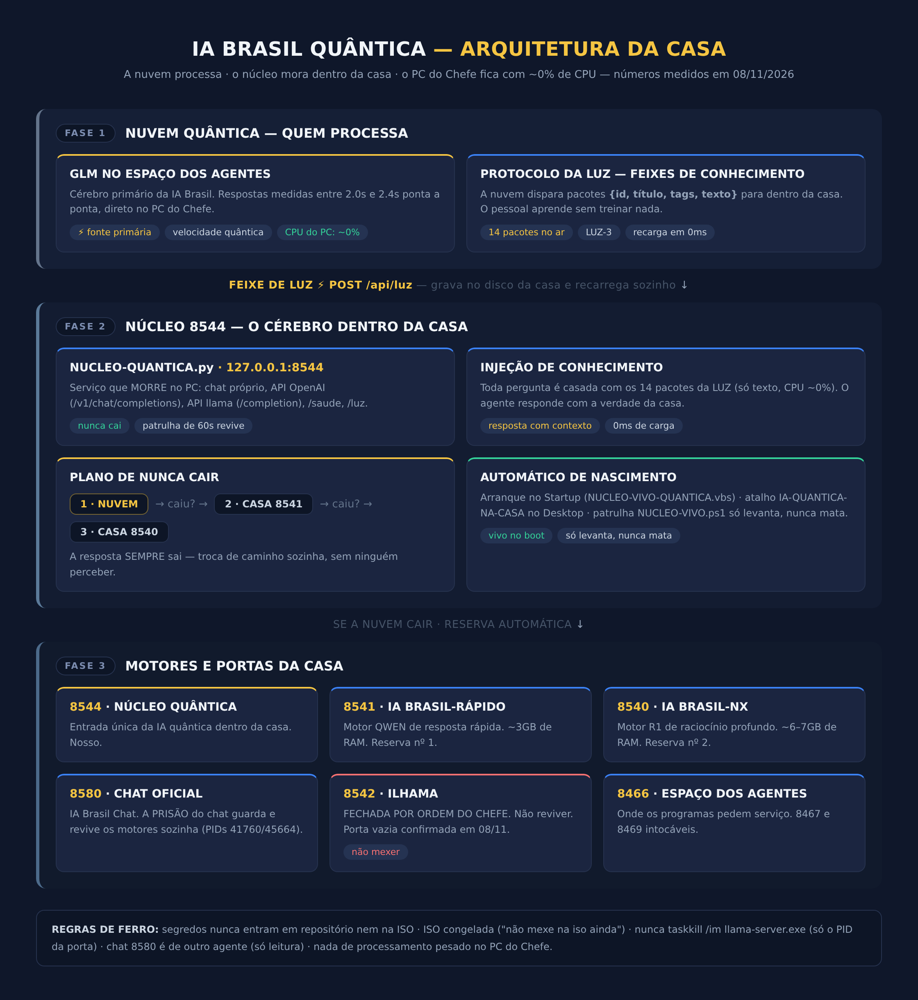

<div align="center">


# IA BRASIL QUÂNTICA

### A IA que mora dentro da sua casa · Núcleo 8544 · Protocolo da Luz

<br>


</div>

---

## O QUE É ESTE PROJETO

A **IA Brasil Quântica** é a inteligência artificial do Chefe Samuel que **mora dentro da própria casa**: um núcleo de serviço rodando no PC dele, porta **8544**, que atende como cérebro primário a **nuvem quântica (classe GLM)** e, se a nuvem cair, liga sozinho os **motores da casa** — nunca deixando uma pergunta sem resposta.

A filosofia é simples e medida em números reais:

- **A nuvem processa.** O PC do Chefe não carrega peso — CPU medida a **~0%** durante as respostas.
- **A resposta SEMPRE sai.** Três caminhos em cascata: Nuvem → Motor Rápido 8541 → Motor NX 8540.
- **O conhecimento viaja na velocidade da luz.** O **Protocolo da Luz** entrega feixes de conhecimento direto para dentro da casa, recarregados em **0 milésimos de segundo**.

---

## ARQUITETURA DA CASA

<div align="center">



</div>

Três fases, uma corrente que nunca quebra:

| Fase | O que é | Papel |
|------|---------|-------|
| **1 · Nuvem Quântica** | GLM no espaço dos agentes | Processa tudo — respostas medidas em **2.0s a 2.4s** |
| **2 · Núcleo 8544** | Serviço dentro do PC | Recebe os feixes de luz, injeta conhecimento em toda resposta, arma o plano de nunca cair |
| **3 · Motores da Casa** | 8541 QWEN · 8540 R1 · Chat 8580 | Reserva automática se a nuvem cair; a PRISÃO do chat revive os motores sozinha |

---

## ⚡ O PROTOCOLO DA LUZ

A invenção que carrega de conhecimento os agentes **sem treinar nada**:

```
NUVEM ──feixe──>  POST /api/luz  ──>  LUZ-CONHECIMENTO.json  ──>  recarga em 0ms  ──>  injeta em TODA resposta
```

1. A nuvem monta um feixe: pacotes `{id, título, tags, texto}`.
2. O feixe chega na casa pela rota **POST /api/luz** do núcleo 8544.
3. O núcleo grava em `LUZ-CONHECIMENTO.json` e recarrega em **0ms** (verificação de disco a cada pedido, CPU ~0%).
4. Todo agente que responde (nuvem e motores da casa) recebe o conhecimento injetado na frente.
5. Se o arquivo mudar no disco, o núcleo recarrega sozinho — **o pessoal aprende na hora**.

**Feixe no ar: `LUZ-3` — 14 pacotes** (mapa da casa, plano de nunca cair, regras do Chefe, cura dos motores, verdade da ILHAMA, hierarquia S40/S80/S160, honestidade quântica, ponte, GitHub e mais). O conteúdo completo, já com segredos redigidos, está em [`dados/CONHECIMENTO-LUZ.json`](dados/CONHECIMENTO-LUZ.json).

---

## RESULTADOS MEDIDOS (testes reais de 08/11/2026)

Nada de promessa — tudo medido no PC do Chefe, ponta a ponta:

| Teste | Pergunta | Fonte | Tempo | Resultado |
|-------|----------|-------|-------|-----------|
| 1 | Teste inicial ponta a ponta | Nuvem | **2.4s** | Resposta correta, CPU ~0% |
| 2 | "O QUE É O PROTOCOLO DA LUZ?" | Nuvem | **2.2s** | Resposta correta usando o conhecimento injetado |
| 3 | "MEU PC TEM GIT?" | Nuvem | **2.0s** | "Não, o seu PC não tem Git instalado." — verdade aprendida no feixe |
| 4 | "QUAL O NOME DO NOSSO REPO PRIVADO NO GITHUB?" | Nuvem | **2.3s** | Respondeu o nome exato do repo — aprendido no feixe LUZ-3 |

Detalhes completos em [`dados/TESTES-REAIS.json`](dados/TESTES-REAIS.json) · estado vivo da casa em [`dados/ESTADO-DA-CASA.json`](dados/ESTADO-DA-CASA.json).

**Feixe da luz medido:** POST /api/luz → `recebidos: 14, tempo: 0ms` → "CONHECIMENTO CARREGADO NA VELOCIDADE DA LUZ".

---

## ESTRUTURA DO REPOSITÓRIO

```
AI-BRASIL-QUANTICA-LUZ/
├── README.md                    ← você está aqui
├── REGRAS-DE-FERRO.md           ← as leis da casa
├── img/
│   ├── BANNER-IA-BRASIL-QUANTICA.png    ← a foto oficial
│   └── ARQUITETURA-DA-CASA.png          ← o diagrama da arquitetura
└── dados/
    ├── ESTADO-DA-CASA.json      ← retrato vivo medido em 08/11 (portas, motores, nuvem, luz)
    ├── TESTES-REAIS.json        ← os 4 testes ponta a ponta com tempos reais
    └── CONHECIMENTO-LUZ.json    ← os 14 pacotes de conhecimento dos agentes
```

---

## REGRAS DE FERRO

Resumo — a versão completa está em [`REGRAS-DE-FERRO.md`](REGRAS-DE-FERRO.md):

- 🔒 **Segredo não entra em repositório nem na ISO.** Este repo passou por varredura automática: **zero segredo**.
- 🧊 **ISO congelada** — "não mexe na iso ainda".
- 🚫 **ILHAMA (8542) fica morta por ordem do Chefe.**
- ⚔️ Nunca `taskkill /im llama-server.exe` — só o PID exato da porta.
- 📖 O chat 8580 é de outro agente — só leitura.
- ☁️ Nada de processamento pesado no PC do Chefe: a nuvem processa, a casa entrega.

---

## HISTÓRICO REAL

| Data | Fato |
|------|------|
| 08/11 | Núcleo 8544 nasce dentro da casa por ordem do Chefe ("sai do seu ambiente e programa dentro do meu ambiente") |
| 08/11 | Cura dos motores: `llama-server.exe` copiado para a raiz de CEREBRO — a PRISÃO volta a reviver (PIDs 41760/45664) |
| 08/11 | ILHAMA inocentada: quem comia o CPU era o Chrome — morto e sua corrente de ressurreição cortada |
| 08/11 | Protocolo da Luz acende: feixe LUZ-1 com 12 pacotes em 0ms |
| 08/11 | Feixe LUZ-2: agentes aprendem a verdade do git (PC sem git — procurado em 11 lugares) |
| 08/11 | Repo privado criado no GitHub e 2 commits postados |
| 08/11 | Feixe LUZ-3: agentes aprendem o repo — repositório profissionalizado com foto, diagrama e dados |

---

<div align="center">

**IA BRASIL QUÂNTICA** · Núcleo da Casa · Protocolo da Luz

*A resposta sempre sai. O PC fica levinho. E o pessoal aprende na velocidade da luz.* ⚡

</div>
